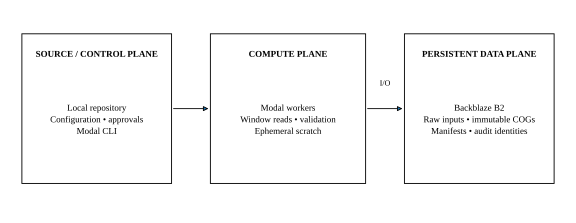

# Vizag GeoAI
### Auditable satellite data engineering for urban-growth research

A geospatial research pipeline for **Visakhapatnam, India**, designed to combine satellite
observations, population, road accessibility and terrain for explainable urban-expansion modelling.

**Current milestone:** Phase 3 and Phase 4 Parts 4.1-4.3 are complete. The fixed grid now has
verified four-epoch satellite-index, terrain, official WorldPop and historically dated OSM features.
The repository does not yet contain a trained prediction model. Feature assembly, labels,
model evaluation and infrastructure-pressure scenarios are the next research stages.

[Public demo](https://vizag-growth-demo.mohan1401.chatgpt.site) ·
[Validation evidence](results/phase3/) ·
[Architecture](tracking/architecture.md) ·
[Build plan](plan.md) ·
[Current status](tracking/tracking.md)

> The demo uses real geography with fictional analytics. It is not connected to model inference.
> No measured prediction accuracy or validated 2030 forecast is claimed.

## Engineering highlights

- **Remote-first raster processing:** GDAL windowed reads access bands inside remote SAFE ZIPs,
  avoiding whole-scene staging. In a two-scene benchmark, this used **98.5% fewer transferred bytes**
  and was **2.8× faster** than fetch-to-staging. These are scoped benchmark results, not a
  system-wide performance guarantee. [Benchmark](results/phase3/read_benchmark.md)
- **Scientific correctness before throughput:** metadata-driven radiometric offsets, band-specific
  nodata, categorical SCL resampling, cloud/shadow dilation and minimum observation support.
  [Extraction contract](docs/phase-3.3-extraction-contract.md)
- **Recoverable publication:** versioned output contracts, persistent Modal reservations,
  existing-output checks and exact-version read-back verification. Ambiguous writes stop for
  reconciliation rather than blindly retrying or overwriting.
- **Evidence-backed quality gates:** full-resolution formula checks, independent SHA-256 checks,
  coverage audits and visual review. Numerical anomalies remain visible instead of being hidden
  by clipping. [Scientific review](results/phase3/gate_review_summary.md)
- **Separation of concerns:** local source/control plane, Modal Python 3.12 compute, and Backblaze B2
  persistent storage. Automated tests use synthetic fixtures and fake storage backends.

## Verified results

Checkpoint: **12 November 2026**.

| Measure | Verified result |
|---|---|
| Automated regression | **402 passed**, one existing warning; executed on Modal |
| Selected input scenes | **32**, eight per epoch: 2018, 2020, 2022, 2024 |
| Scene products | 32 six-band reflectance stacks + 32 categorical SCL rasters |
| Composite products | Four median composites + four valid-observation count rasters |
| Spectral products | Five indices × four epochs = **20 COGs** |
| Total production rasters | **92 COGs**, 13,419,102,871 bytes |
| Analysis raster grid | 10 m, UTM zone 44N, EPSG:32644 |
| Published archive | 16 frozen document/config snapshots + one completion manifest |
| Context features | **25,484 rows**: 6,371 cells × 4 epochs, contract 4.3.1 |

COG means Cloud Optimized GeoTIFF: a raster format supporting efficient partial reads.

The latest recorded full-suite run is
[available on Modal](https://modal.com/apps/sankar132095/main/ap-qM49ppnEZBbOXuah2lWjUF)
(402 passed; one existing all-NaN synthetic-median warning).
Automated tests validate implementation behaviour; separate real-data audits validate published
outputs. Neither establishes prediction accuracy.

## Runtime architecture



The existing runtime diagram describes the infrastructure split. The broader
[research architecture](results/project_report/system_architecture.svg) is a **dated Part 3.5
design snapshot**; dashed components were planned at that checkpoint.

The implemented processing sequence is:

1. Inventory B2 objects and reconcile actual study-area requirements.
2. Inspect archive metadata, catalogue epochs and select usable scenes.
3. Correct reflectance using scene metadata; extract aligned AOI windows.
4. Mask invalid observations using band nodata and scene-classification data.
5. Create per-epoch median composites and observation-count rasters.
6. Calculate guarded NDVI, NDBI, NDWI, MNDWI and BSI products.
7. Audit grids, formulas, hashes, coverage and anomalies; publish review evidence.
8. Build and visually approve 6,371 stable 500 m analysis cells.
9. Aggregate the five indices for four epochs plus elevation and slope, preserving per-cell support QC.
10. Acquire one official WorldPop release and dated ohsome/OSM snapshots for every epoch.
11. Aggregate population and infrastructure context into all 6,371 cells with exact-version provenance.

See the [architecture and operational safeguards](tracking/architecture.md) for details.
B2 publication protections depend on cooperative exclusive writers; ordinary object PUT is
**not an atomic create-if-absent guarantee** against unrelated external writers.

## Data and study area

The verified GVMC administrative boundary is **625.15 km²**; processing uses a **5 km buffer**
around it. The buffered study area is larger than the administrative boundary.
[Boundary validation](results/phase1_boundary_check.png)

| Dataset | Role and current state |
|---|---|
| Sentinel-2 Level-2A | Four-epoch imagery; selected scenes processed through Phase 3 |
| WorldPop | Official Global2 R2025A, 100 m rasters for all four epochs; aggregated in Part 4.3 |
| OpenStreetMap | ohsome API v2 historical roads and amenities for all four epochs; aggregated in Part 4.3 |
| Copernicus GLO-30 DEM | Validated and aggregated to cell-level elevation and slope in Part 4.2 |
| ESA WorldCover | Acquired land-cover input; suitability for label generation/cross-checking remains to be validated |

The raw inventory contains **280 Sentinel-2 archives, approximately 182.82 GB**, across the
inventoried tiles and epochs. The required tile is `T44QQE`: all **86 required-tile archives**
passed the structural ZIP-directory audit for required assets. This was not a full-payload
integrity hash of every raw archive.
[Inventory](results/phase2/inventory_report.md) · [Reconciliation](results/phase2/missing_report.md)

### Composite quality

Each composite pixel needs at least four valid observations; each epoch must retain at least
99% coverage inside the buffered AOI.

| Epoch | AOI coverage meeting observation requirement |
|---|---:|
| 2018 | 99.6693% |
| 2020 | 99.9107% |
| 2022 | 99.7986% |
| 2024 | 99.3729% |

[Composite audit](results/phase3/composite_validation.md) ·
[Index audit](results/phase3/indices_validation.md) ·
[Archive completion](results/phase3/archive_completion.md)

### Scientific limitation and approved handling

The native review found **11,378 unique outlier pixels in 2018**, **12 in 2022**, and none in
2020 or 2024. Rare negative input terms and denominator cancellation can produce extreme finite
ratios. Original rasters were preserved; the exact physical source causes are not established.

The approved future feature rule excludes only flagged values from the affected index mean,
retains support/exclusion counts, and leaves empty means missing. It does not clip original
rasters or automatically remove whole cells. Part 4.2 implements this rule. The approved downstream
eligibility threshold is 50% usable support per required index/epoch plus valid elevation and slope.

[Approved policy](configs/feature_aggregation.yaml) ·
[Part 4.2 completion evidence](results/phase4/features/contract-4.2.0/part4_2_completion.md) ·
[Part 4.2 scientific review](results/phase4/features/contract-4.2.0/feature_scientific_review.json) ·
[Prediction-quality plan](docs/phase-4-prediction-quality-plan.md) ·
[2018 QC](results/phase3/qc_2018.png) ·
[2020 QC](results/phase3/qc_2020.png) ·
[2022 QC](results/phase3/qc_2022.png) ·
[2024 QC](results/phase3/qc_2024.png)

## Repository structure

```text
configs/               Non-secret, versioned processing and storage policies
src/acquisition/       Inventory, reconciliation and acquisition checks
src/preprocessing/     Radiometry, extraction, masks, composites, indices and QC
src/storage/           Storage backends, manifests, archive audit and publication
src/utils/             Configuration, validation, logging and redaction
tests/                 Unit and integration tests using controlled fixtures
modal_app.py           Remote Python 3.12 image and explicit job dispatcher
results/               Validation reports, QC figures and reviewed report assets
docs/                  Processing contracts, decisions and next-step proposals
tracking/              Status, handoff, engineering decisions and change history
plan.md                Authoritative phase-by-phase implementation plan
```

Runtime datasets, credentials, models and local caches are not source artifacts.
The demo website has its own separate repository and is not embedded in this repository.

## Reproduce the checks

Use a local virtual environment as the **control plane**. Scientific execution and tests run
on Modal Python 3.12; a local Python 3.11 installation can launch the source-based application.
No local geospatial stack is needed for these launch commands.

```powershell
python -m venv .venv
.\.venv\Scripts\Activate.ps1
python -m pip install "modal>=1.5,<2.0" "pyyaml>=6,<7"

# Interactive authentication; select the intended workspace.
modal token new

$env:PYTHONIOENCODING = "utf-8"
[Console]::OutputEncoding = [System.Text.UTF8Encoding]::new()
modal run -e main modal_app.py --action test
```

The application is configured for workspace `sankar132095`, environment `main`.
For the configured remote functions, provision the named Modal Secret `vizag-b2` privately,
with `B2_KEY_ID` and `B2_APPLICATION_KEY`; do not commit credentials or upload a local `.env`.
Bucket and endpoint configuration is in [configs/b2.yaml](configs/b2.yaml).

The test action launches paid Modal compute but does not process production imagery or read/write
real B2 data. Production processing and transfer-heavy audits require separate workload approval.

**Do not rerun populated production contracts.** Existing scene, composite, index, archive and
QC destinations must remain intact. Review [the handoff](tracking/handoff.md) before operating jobs.
There is no production prediction CLI yet.

## Roadmap: from imagery to reliable predictions

| Stage | Status |
|---|---|
| Study boundary and acquisition | Phases 1–2 complete, gate-confirmed |
| Satellite preprocessing, indices and archive | Phase 3 complete, gate-confirmed |
| 500 m research grid | Part 4.1 complete and visually approved; 6,371 validated cells |
| Cell-level satellite/terrain features | Part 4.2 complete; six outputs verified, 6,355 cells meet the approved support/terrain rule |
| Cell-level population/infrastructure context | Part 4.3 complete; 25,484 validated cell-year rows under contract 4.3.1 |
| Leakage-safe assembled feature table | Part 4.4 complete; 25,484 rows, 69 columns, 6,355 model-eligible cells under contract 4.4.0 |
| Built-fraction change labels | Phase 5 complete and gate-approved; 5%/10%/20% sensitivity reviewed and 10 percentage points confirmed as the primary threshold |
| Logistic and tree-based baselines | Planned |
| Temporal holdout, spatial robustness and calibration | Planned |
| Explanations and infrastructure-pressure scenarios | Planned |

The evaluation plan separates historical transitions for training from a later temporal holdout,
with spatial robustness checks. Proposed metrics include PR-AUC, F1, Brier score and calibration;
**no model scores have been measured yet**. A two-year transition model cannot by itself establish
a reliable six-year 2030 forecast. Any infrastructure-pressure index will be a documented research
heuristic, not a measured infrastructure-capacity deficit.

Phase 0 implementation is complete, with its historical formal gate still pending.
The [quality plan](docs/phase-4-prediction-quality-plan.md) records the approved feature rule and
the safeguards still required for later prediction work. Phase 4 implementation is complete.
Phase 5.1 rejected the original fixed spectral-rule classifier after it under-detected about
85% of the WorldCover built pixels. Corrected Dynamic World contract 5.1.1 masks all four epochs
to the approved buffered GVMC AOI: 15,353,996 valid 10 m pixels per epoch and zero valid pixels
outside it. The final table contains 25,484 unique `(grid_id, epoch)` rows. It preserves all
6,371 cells; 6,368 have raster evidence and three tiny boundary slivers are explicitly unsupported.
Both classified built fraction and soft probability/uncertainty evidence are retained. Phase 5.2
adds 19,113 rows across the 2018–2020 and 2020–2022 training transitions and the fully separated
2022–2024 temporal holdout. Phase 5.3 validated 57,339 threshold rows at 5%, 10% and 20%.
The predeclared 10-percentage-point threshold was explicitly confirmed at the Phase 5 gate on
14 November 2026. No prediction model exists yet.

## Documentation

- [Authoritative build plan](plan.md) and [live progress](tracking/progress.md)
- [Architecture and decisions](tracking/architecture.md)
- [Read-strategy decision](docs/decisions/ADR-001-read-strategy.md)
- [Part 4.3 completion and provenance](docs/phase-4.3-context-completion.md)
- [Part 4.4 completion, error correction and immutable outputs](docs/phase-4.4-completion.md)
- [Phase 5.1 method history, Dynamic World pilot and current gate](docs/phase-5.1-preflight.md)
- [Phase 5.2 transition-label completion and provenance](docs/phase-5.2-completion.md)
- [Phase 5.3 threshold sensitivity and Phase 5 gate](docs/phase-5.3-completion.md)
- [Reviewed academic report — PDF](results/project_report/Vizag_GeoAI_Project_Report_Reviewed.pdf)
- [Editable academic report — Word](results/project_report/Vizag_GeoAI_Project_Report_Reviewed.docx)
- [Report scope and diagram notes](results/project_report/README.md)

The academic report is a **6 November Part 3.5 draft**, with identity/signature placeholders.
Illustrative locality values are not observed predictions. Current implementation status comes
from the later validation evidence and tracking records linked above.
