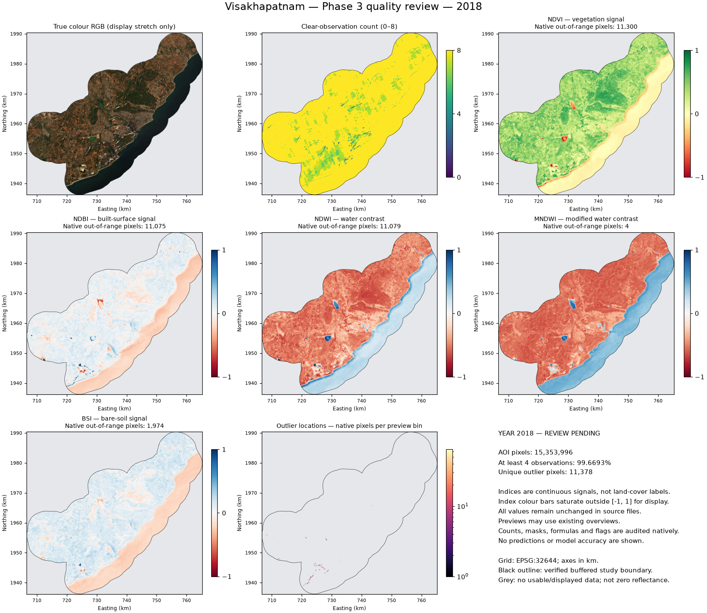
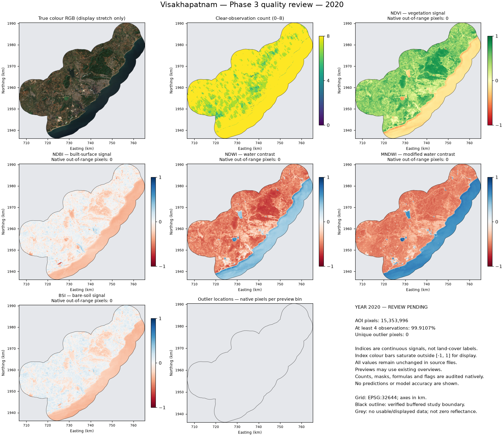
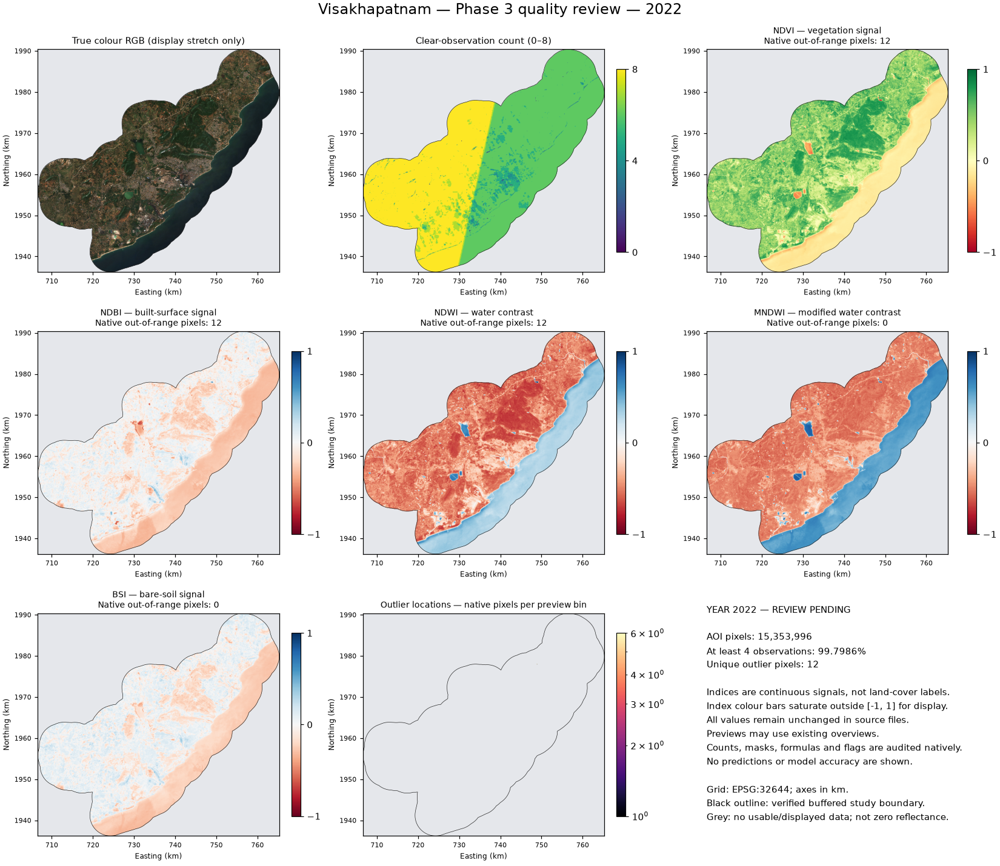
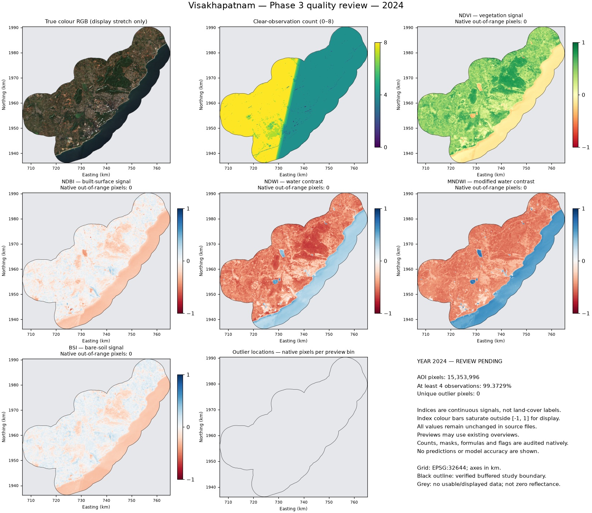

# Phase 3 visual/scientific review

**Evidence generated; user visual review and downstream eligibility policy remain pending.**

## Key — what the panels mean

RGB: true-colour reflectance preview. Count: clear observations out of eight.
NDVI: vegetation contrast; NDBI: built-surface contrast; NDWI/MNDWI: water contrast;
BSI: bare-soil contrast. These are continuous signals, not classified land cover or predictions.

Grey indicates unavailable display data. RGB uses a common 0–0.30 display stretch.
Index colours saturate at [-1,1] for display only; source values are unchanged.
Previews may use overviews. Counts, formula checks and flagged locations are measured natively.

## Measurements

| Year | AOI coverage at >=4 observations | Unique outlier pixels |
|---|---:|---:|
| 2018 | 99.6693% | 11,378 |
| 2020 | 99.9107% | 0 |
| 2022 | 99.7986% | 12 |
| 2024 | 99.3729% | 0 |

Outlier sets overlap across indices; the unique count is their pixel-wise union.

| Year | Index | Range outliers | Outliers with negative ratio term | Minimum | Maximum | Minimum cancellation ratio |
|---|---|---:|---:|---:|---:|---:|
| 2018 | NDVI | 11,300 | 11,300 | -379.001 | 341.001 | 0.002638518 |
| 2018 | NDBI | 11,075 | 11,075 | -3806.94 | 2208.96 | 0.00026267846 |
| 2018 | NDWI | 11,079 | 11,079 | -30.2307 | 25.9412 | 0.033078919 |
| 2018 | MNDWI | 4 | 4 | -1.11351 | 0.887664 | 0.89805911 |
| 2018 | BSI | 1,974 | 1,974 | -2.44423 | 17.6275 | 0.056729693 |
| 2020 | NDVI | 0 | 0 | -0.828037 | 0.891545 | not applicable |
| 2020 | NDBI | 0 | 0 | -0.838952 | 0.711303 | not applicable |
| 2020 | NDWI | 0 | 0 | -0.834327 | 0.895455 | not applicable |
| 2020 | MNDWI | 0 | 0 | -0.827505 | 0.878724 | not applicable |
| 2020 | BSI | 0 | 0 | -0.556742 | 0.577441 | not applicable |
| 2022 | NDVI | 12 | 12 | -1.01606 | 0.898067 | 0.98418972 |
| 2022 | NDBI | 12 | 12 | -0.880447 | 1.09679 | 0.91175456 |
| 2022 | NDWI | 12 | 12 | -0.856627 | 1.00911 | 0.99097065 |
| 2022 | MNDWI | 0 | 0 | -0.803426 | 0.853982 | not applicable |
| 2022 | BSI | 0 | 0 | -0.581626 | 0.584503 | not applicable |
| 2024 | NDVI | 0 | 0 | -0.698061 | 0.894135 | not applicable |
| 2024 | NDBI | 0 | 0 | -0.855951 | 0.82172 | not applicable |
| 2024 | NDWI | 0 | 0 | -0.810143 | 0.78988 | not applicable |
| 2024 | MNDWI | 0 | 0 | -0.851246 | 0.845375 | not applicable |
| 2024 | BSI | 0 | 0 | -0.59913 | 0.704923 | not applicable |

## How to interpret the numerical diagnostics

Each index is a ratio of a difference to a sum. Its two ratio terms are recorded in the CSV.
For BSI the terms are sums of bands. Opposite-sign terms can yield ratios beyond [-1,1].
Cancellation ratio = abs(left + right) / (abs(left) + abs(right)); smaller values mean
stronger cancellation. It is a continuous diagnostic, not a new accepted/rejected threshold.
Negative corrected reflectance is preserved by the approved contract. This review identifies
its mathematical effects; it does not establish the physical cause in an individual source scene.

The JSON includes global means both with all valid values and with range outliers omitted
as a sensitivity diagnostic only. These are not 500 m features and do not authorize exclusion.

## Review images

### 2018

### 2020

### 2022

### 2024

## Existing epoch-feasibility evidence

This is the exact existing report, read from a pinned B2 version; catalogue feasibility
was not recomputed in this review.

> # Epoch Feasibility — Phase 3, Part 3.1
> 
> Pixel data was not read. Boundary coverage is assessed against the required MGRS tiles
> computed in Phase 2; cloud usability is assessed separately in Part 3.2.
> 
> ## 2018 — FEASIBLE
> 
> - Raw archive records: 68
> - Complete preferred candidates on required tiles: 19
> - L2A / L1C: 19 / 0
> - Tiles: T44QQE
> - Date spread: 2018-01-03 to 2018-04-26
> - Processing baselines: N0500
> - Duplicate records: 0
> - Issues: none
> 
> ## 2020 — FEASIBLE
> 
> - Raw archive records: 72
> - Complete preferred candidates on required tiles: 22
> - L2A / L1C: 22 / 0
> - Tiles: T44QQE
> - Date spread: 2020-01-06 to 2020-05-10
> - Processing baselines: N0500
> - Duplicate records: 0
> - Issues: none
> 
> ## 2022 — FEASIBLE
> 
> - Raw archive records: 70
> - Complete preferred candidates on required tiles: 21
> - L2A / L1C: 21 / 0
> - Tiles: T44QQE
> - Date spread: 2022-01-05 to 2022-05-22
> - Processing baselines: N0400, N0510
> - Duplicate records: 0
> - Issues: none
> 
> ## 2024 — FEASIBLE
> 
> - Raw archive records: 70
> - Complete preferred candidates on required tiles: 24
> - L2A / L1C: 24 / 0
> - Tiles: T44QQE
> - Date spread: 2024-01-10 to 2024-05-31
> - Processing baselines: N0510
> - Duplicate records: 0
> - Issues: none
> 
> ## Decision
> 
> All configured epochs pass catalogue-level L2A/tile feasibility. User confirmation is still required.

## Decision still required

Inspect the actual images, count/range tables and sampled locations. Decide whether deeper
source-scene review is needed and approve a scientifically justified downstream eligibility
policy before aggregation. No automatic clipping or omission has been implemented.
This review does not approve the Phase 3 gate or start Phase 4.
